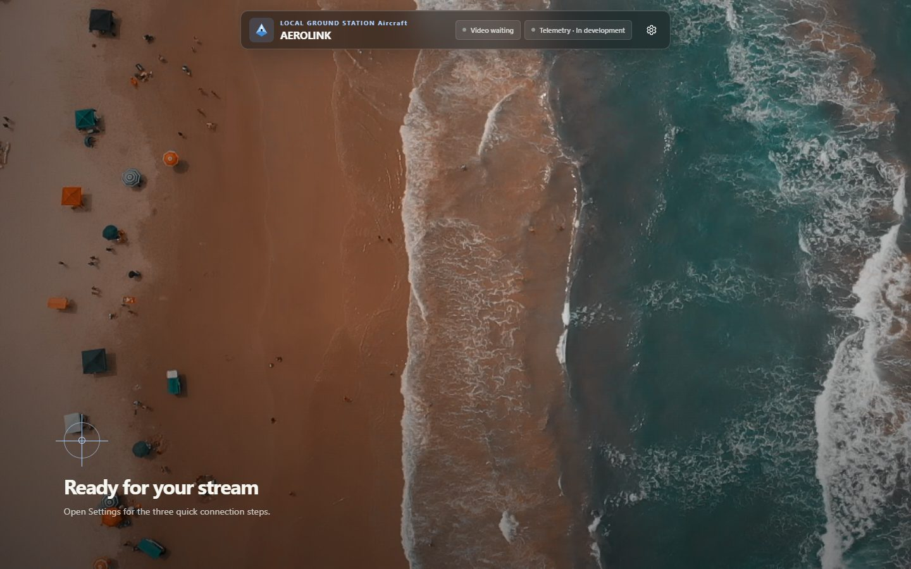

# AEROLINK


**A quiet, local RTMP flight viewer for DJI Fly and other RTMP publishers.**

[Download for Windows](https://github.com/JadenAhYuen/AEROLINK/releases/latest)
· [Build status](https://github.com/JadenAhYuen/AEROLINK/actions/workflows/release.yml)

> AEROLINK is a secondary monitor, not a flight-control system. Always pilot
> from the approved DJI controller, maintain visual line of sight, and follow
> applicable aviation and privacy rules.

## Preview



The viewer starts with an optional, skippable welcome transition, then presents
a full-screen camera canvas. When a feed connects, the header fades away; move
the pointer over its position to bring it back. Telemetry and the flight track
are off by default and can be deliberately enabled in Settings.

## What it does

- Ingests RTMP from DJI Fly or another compatible RTMP/H.264 publisher.
- Plays the stream in the browser through MediaMTX WebRTC.
- Uses separate, generated stream keys for multiple aircraft.
- Keeps an RTMP server link, stream key, and complete address clearly separated in Settings.
- Provides an OBS/vMix **Clean streaming output** browser-source mode.
- Presents a polished waiting state until a live feed is available.
- Offers telemetry and a home-relative track as an **in-development** feature,
  with an optional simulated preview in Settings.
- Shows optional wind, gusts and conditions for chosen coordinates, with a
  model-specific flight weather estimate independent of telemetry.

## Flight weather

In **Settings → Flight weather**, select a DJI model, enter latitude and longitude,
and choose **Check conditions now**. Turn on **Weather overlay** and select
**Done** to keep the panel on the viewer. Each feed saves its own location and
model. The panel refreshes while open. A device location button is available
where the browser permits location access; coordinates can always be entered.

The estimate uses Open-Meteo's modelled conditions near the requested point,
including wind and gusts at **10 m**. It is not a measurement at the aircraft or
at its flight altitude. The result combines weather with the selected DJI
model's published maximum wind resistance and an optional lower pilot limit.
The Lito X1 wind rating could not be verified from DJI's accessible material;
its profile remains **unverified** and requires a pilot limit for a cautionary
estimate. A favourable result is not a flight clearance. Wind can change at any
time. Check conditions on site and fly within the aircraft manual and local rules.

Weather requires internet access. Enabling the overlay or checking conditions
sends the chosen coordinates to Open-Meteo. Its free API is for noncommercial
use; deployments needing commercial rights should configure an
`OPEN_METEO_API_KEY` for the customer API. See [weather method and model sources](docs/WEATHER.md).

## Start

For Windows 10/11, extract the portable release ZIP and double-click
**AEROLINK.exe**. Node.js and MediaMTX are included. The viewer opens automatically;
the launcher shows the address to use on a tablet. Keep the launcher open while
flying. Close it or choose **Stop** to stop its services; **Retry** starts them again.

To run from source, install Node.js 22+ and use:

```powershell
.\start.ps1
```

The launcher starts the local dashboard and MediaMTX, then prints the laptop
address. Allow Node.js and MediaMTX through Windows Firewall on your **private**
network when prompted.

Open the dashboard at `http://<laptop-ip>:3000`.

## Connect a camera

1. Open **Settings** in AEROLINK.
2. For separate fields, enter **RTMP server link** as the server and **stream key**
   as the key. For one address field, use the complete address shown below them.
   For example, server `rtmp://192.168.1.44` plus key `drone-1xpryk` produces
   `rtmp://192.168.1.44/drone-1xpryk`. Do not append the key twice.
3. In DJI Fly, open **Transmission → Live Streaming → RTMP**, enter the values,
   then start streaming.
4. The live picture replaces the waiting state automatically.

### Multiple aircraft

Select **Generate** beside Stream key, then choose **Open feed**. AEROLINK makes
a short random key such as `drone-1xpryk` and a matching viewer link. Open one
viewer link per aircraft.

Each feed has an isolated video path, stream status, telemetry event stream,
latest observation, and saved dashboard profile. Send receiver telemetry for a particular aircraft to:

```text
http://<laptop-ip>:3000/api/telemetry?stream=<stream-key>
```

## Clean output

Enable **Clean streaming output** in Settings to obtain a browser-source URL for
OBS or vMix. Choose **Copy link** or **Open output**; the main viewer stays available.
The output excludes AEROLINK controls and telemetry while preserving the
waiting state, so a program feed never goes blank before the drone connects.

## Telemetry and desk testing

In **Settings → Telemetry · In development**, select **Run telemetry demo** to
preview simulated data for the current feed. Enable the overlay or track to see it.

**Real Remote ID reception is in development.** The API accepts decoded receiver
observations, but this app has no built-in radio receiver or receiver bridge.
Entering a real UAS ID or operator ID changes a display label; it cannot retrieve
telemetry. RTMP is the video feed. A compatible external receiver and bridge are
needed for telemetry, and that aircraft integration has not been flight-tested.
See [Remote ID integration](docs/REMOTE_ID.md).

To test a camera feed with FFmpeg:

```powershell
ffmpeg -re -f lavfi -i testsrc2=size=1280x720:rate=30 `
  -c:v libx264 -preset ultrafast -tune zerolatency -an `
  -f flv rtmp://localhost/x
```

## Compatibility

AEROLINK accepts any local RTMP/H.264 publisher; it is not tied to DJI RC 2.
Whether a DJI setup can publish RTMP depends on the aircraft, controller, DJI
Fly version, and firmware. Confirm your exact combination in DJI’s current
[DJI Fly livestream guide](https://repair.dji.com/help/content?customId=01700006727&lang=en&paperDocType=ARTICLE&re=US&spaceId=17).

## Attribution

- The AEROLINK logo is an original SVG created for this project.
- See [third-party notices](THIRD_PARTY_NOTICES.md) for bundled runtime licenses.

## Development

```powershell
npm test
npm run test:coverage
npm run build:windows
```

The Windows build is written to `dist/`. GitHub Actions verifies changes and builds
the portable ZIP. A new package version pushed to `main` publishes a GitHub release;
existing release versions are preserved. A `v*` tag also runs the release workflow.
See [release notes](docs/RELEASE_NOTES.md) and the [release review](docs/REVIEW.md)
for validation limits and outstanding work.

| Port | Protocol | Purpose |
|---:|---|---|
| 1935 | TCP | RTMP ingest |
| 3000 | TCP | Dashboard and telemetry API |
| 8889 | TCP | WebRTC player |
| 8189 | UDP | WebRTC media |

Keep all ports on the trusted local flight network; this project does not
configure internet exposure.
